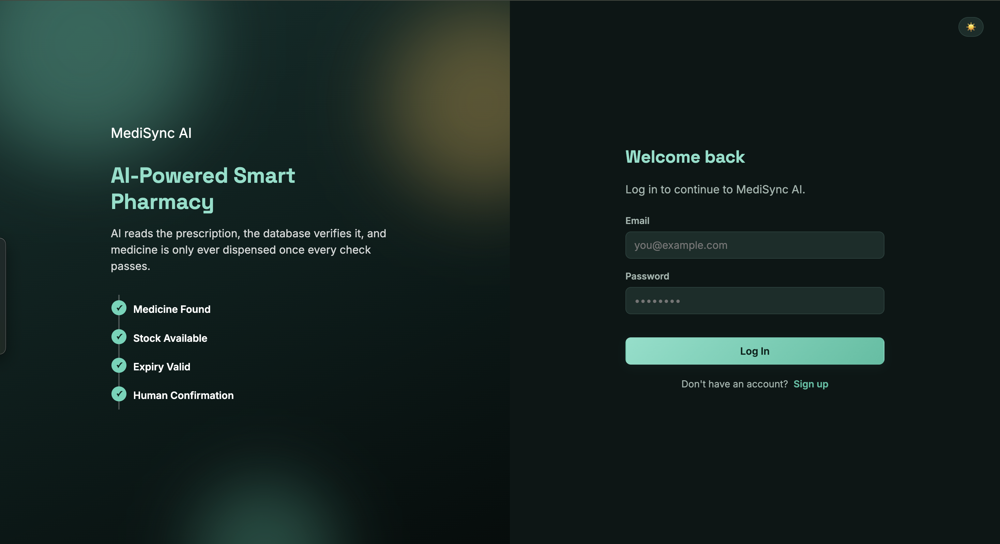
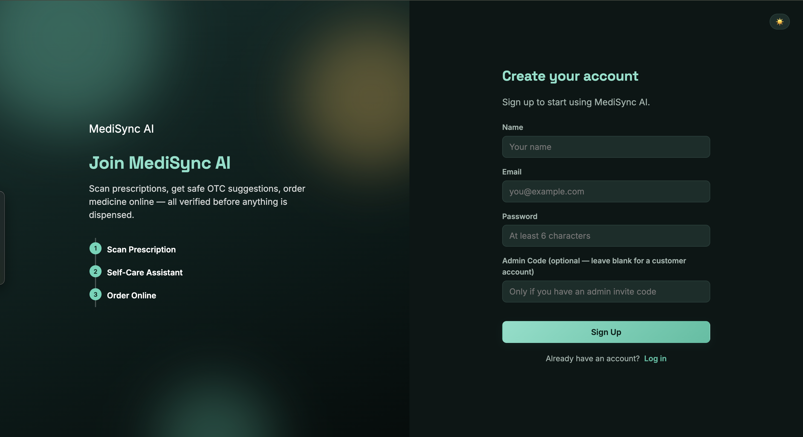
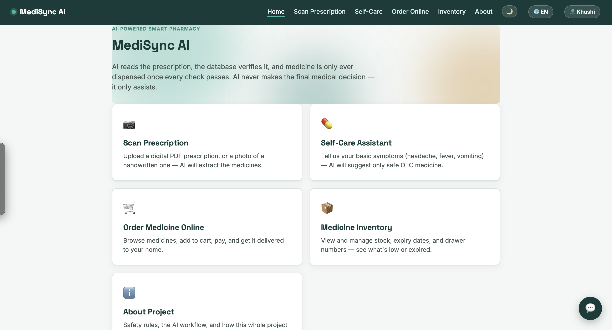
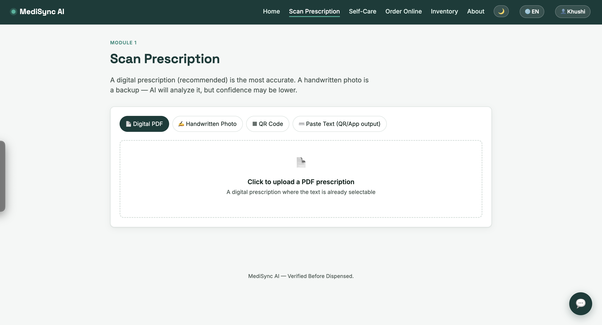
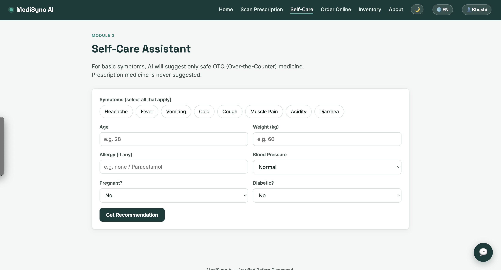
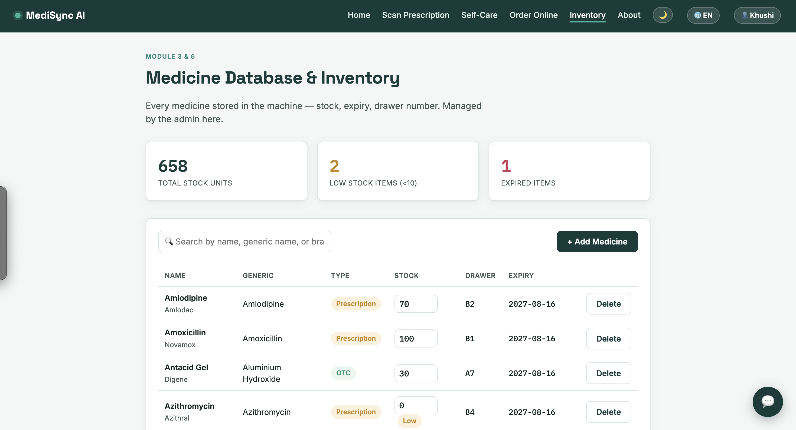
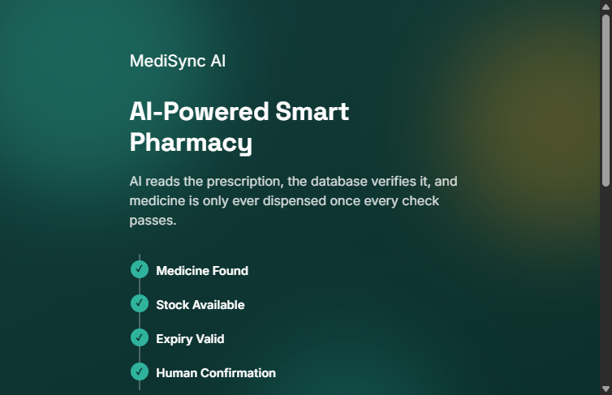
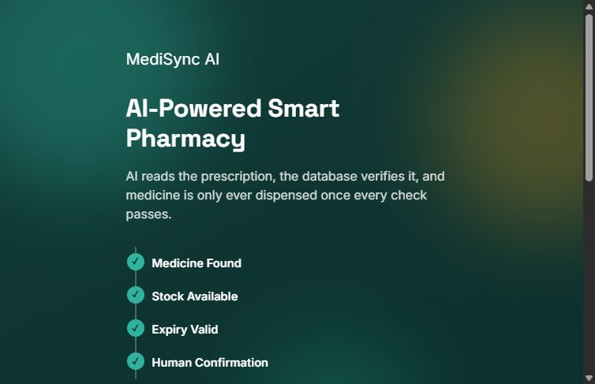
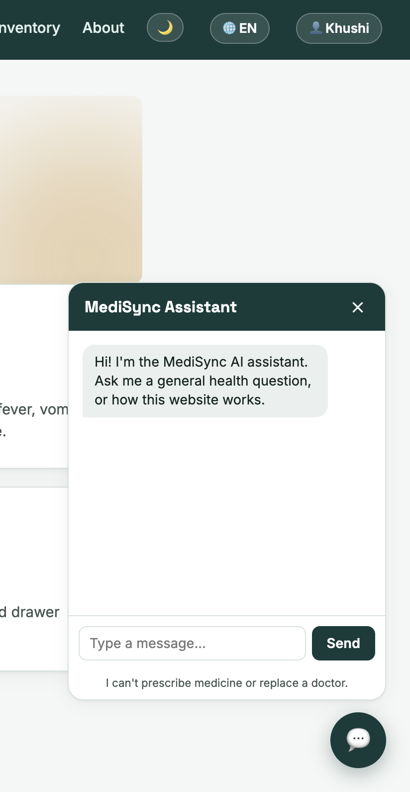
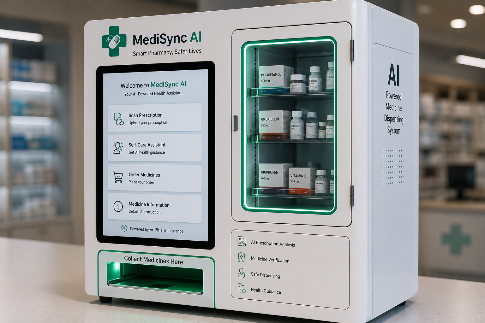

# MediSync AI

**AI-Powered Smart Pharmacy & Prescription Management System**

MediSync AI is an AI-assisted healthcare platform that simplifies prescription processing, medicine verification, inventory management, and pharmacy automation. The platform combines AI-powered OCR with secure verification to improve healthcare accessibility, efficiency, and patient safety.

---

## Features

- **Doctor Appointment Booking System**: Search verified specialists, browse profiles and consultation fees, check real-time availability slots, and book/cancel appointments.
- **Doctor Management Portal**: Dedicated portal for certified doctors to manage practice profiles, schedule clinical availability slots, and update consultation statuses with clinical notes.
- **Digital Health Records Management**: Secure storage for medical reports (PDF/images), health profile tracking (blood group, vitals, allergies, emergency contacts), and patient health dashboard.
- **AI-Powered Medical Report Summarization**: Integrated Google Gemini AI to analyze lab reports and extract key parameters into easy-to-understand findings, clinical explanations, and recommendations with medical disclaimers.
- **AI-Powered Smart Medication Reminders**: Schedule daily dose alarms, track on-time adherence compliance with visual metrics, log doses as taken/skipped, and generate optimal dosing schedules using Gemini AI.
- **Prescription OCR & Verification**: Handwritten, printed, digital PDF, and QR prescription scanning with multi-step medicine verification.
- **Online Medicine Ordering & Inventory**: Browse pharmacy catalog, cart verification, order simulation, and stock management.
- **AI Health Chatbot & OTC Self-Care Assistant**: Safe, cautious health assistance powered by Gemini.
- **Role-Based Authentication**: Support for Customer, Doctor, and Admin accounts with token sessions.
- **Multi-language Support & Dark/Light Mode**: Full localization across 5 languages with clean, responsive themes.

---

## Upcoming Features

- Pathology & Lab Test Booking
- Cloud-Based Distributed Health Records
- Real Online Payment Gateway (Razorpay)
- Real Courier Tracking Integration (Shiprocket)
- AI-Powered Smart Medicine Dispensing Machine (Hardware Kiosk)

---

## Technology Stack

| Category | Technologies |
|----------|--------------|
| Frontend | HTML, CSS, JavaScript |
| Backend | FastAPI (Python) |
| Database | SQLite |
| AI | Google Gemini API |
| Deployment | Render |
| Version Control | Git & GitHub |

---

## Project Screenshots

| Login | Sign Up |
|--------|---------|
|  |  |

| Home | Prescription Scanner |
|------|----------------------|
|  |  |

| Self-Care Assistant | Inventory |
|---------------------|-----------|
|  |  |

| Doctor Appointments | Specialist Directory |
|---------------------|----------------------|
|  |  |

| Digital Health Records | Smart Medication Reminders |
|------------------------|---------------------------|
|  |  |

---

## AI Chatbot

  

---

## Smart Medicine Dispensing Machine (Concept)

  

> **Note:** This image represents the conceptual design of the proposed AI-powered medicine dispensing kiosk. It illustrates the future hardware vision of the MediSync AI project.

---

## Doctor Appointments & Specialist Directory

  

---

## Digital Health Records (EHR) & AI Report Summarizer

  

---

## Smart Medication Reminders & Dosage Schedules

  

---

## Project Documentation

**Project Proposal (PDF)**

📄 [Download Project Proposal](docs/MediSync_AI_Project_proposal.pdf)

**Detailed Project Documentation**

https://docs.google.com/document/d/1_ZxrJnsKeNOnPCR0dzQb1bvX01qvqQLY0p1hypX6B6s/edit?usp=sharing

---

## Future Vision

MediSync AI aims to become a complete AI-powered healthcare ecosystem by integrating:

- Smart Pharmacy Automation
- Robotic Medicine Dispensing
- Doctor Appointment Management
- Pathology & Lab Test Booking
- Digital Health Records
- Medicine & Appointment Reminders
- Cloud-Based Inventory Management
- Secure Online Payments

---

## Contributors

- **Khushi Chandra** — B.Tech CSE, Motilal Nehru National Institute of Technology Allahabad
- **Jyoti Meena** — B.Tech CSE, Motilal Nehru National Institute of Technology Allahabad
